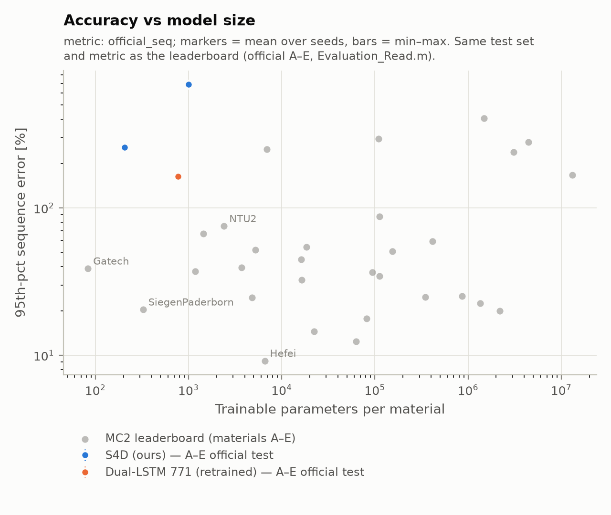

# Phase 1: official A–E protocol, first real run (2026-11-05, MacBook M3 Pro, MPS)

**Status: first real numbers. These are baselines, not a result to claim.** One seed per model,
one training recipe, no tuning.

## Protocol

For each final-test material A–E: train on that material's released training data only (90%
of sequences for training, 10% held out), roll out on the **official A–E test set**, write
`H_Material <L>.csv`, and score it with `src.score_submission`. That scorer reproduces the
organizers' published scores to 4 decimals for Hefei, Gatech, Cambridge and SiegenPaderborn,
so the numbers below are directly comparable to the leaderboard: same test set, same metric.

Recipe: teacher-forced next-step MSE, Adam lr 1e-3 decayed x0.6 every 25 epochs, 80 epochs,
batch 2048, 500k training windows per material, tied normalization fitted on the training
split. The checkpoint is selected by the 95th-percentile rollout error on held-out validation
segments (200 segments, the test set's warm-ups), every 5 epochs. Command:
`~/magnet-data/runs/overnight.sh`. Wall clock about 2 h 55 min for all 15 runs.

## Results (official score, %, lower is better)

Sequence error (per-warm-up 95th percentile, averaged over blocks):

| model | params | A | B | C | D | E | **mean** | rank among 32 teams + ours |
|---|---|---|---|---|---|---|---|---|
| Dual-LSTM, official arch. (retrained) | 771 | 257.1 | 207.9 | 170.9 | 85.1 | 94.4 | **163.1** | 25 / 35 |
| S4D small (d4, L1, N8) | 205 | 114.4 | 278.1 | 709.0 | 109.8 | 77.1 | **257.7** | 29 / 35 |
| S4D medium (d8, L2, N16) | 1,001 | 987.8 | 902.9 | 659.4 | 614.3 | 283.9 | **689.6** | 33 / 35 |

Energy error: 771-LSTM 49.0, S4D small **29.8**, S4D medium 104.0 (mean over A–E).

Reference points from the leaderboard (same metric, per-material mean): Hefei 9.2 % (6,564
params); SiegenPaderborn 20.4 % (325); Cambridge 37.0 % (1,182); Gatech 38.8 % (83); NTU2 75.1 %
(the stock 2,399-param tutorial LSTM).

## What this shows

1. **All three models are far from the competitive small models.** The best mean (163 %) is
   about 8x SiegenPaderborn at a similar size. Our retrained 771-param LSTM is also about 2x
   worse than NTU2's stock 2,399-param LSTM. Some of that is model size, but the recipe is
   clearly not at a competitive level yet.
2. **The failure is autoregressive drift, not fitting.** Next-step training MSE ends at
   1e-4 to 6e-3 (normalized), while the rollout error across checkpoints swings by 10–100x
   (e.g. LSTM on B: 65 % to 4,610 % on validation between checkpoints 5 epochs apart).
   Teacher-forced training does not control long-horizon stability.
3. **Model selection is noisy.** Because validation rollout error jumps between checkpoints,
   the selected checkpoint sometimes transfers badly (S4D small, C: 47 % on validation, 709 %
   on test; B: 47 % vs 278 %). It transfers well elsewhere (A, D, E within about 10–30 %).
   200 validation segments and one checkpoint every 5 epochs is too coarse.
4. **Bigger S4D was worse.** The 1,001-param S4D drifts more than the 205-param one on every
   material. With this recipe, extra capacity fits the next step better and generalizes worse
   over 900 steps. This should not be read as an SSM-vs-LSTM conclusion yet.
5. **S4D small has the best energy error (29.8 %)** and beats the LSTM on A and E with a
   quarter of the parameters, but is unstable on C (no H history) and B.

## Next steps this points to

- Phase 2 (running): the same models with Gaussian noise on the H history during training
  (`--h-noise 0.05`), a standard counter to exposure bias. Results go to
  `results/final_AtoE_hnoise/`.
- Train on rollouts, not just next steps: multi-step / scheduled-sampling loss, or a
  truncated-BPTT rollout loss on short horizons. This is the most likely large win.
- Steadier selection: more validation segments, checkpoints every epoch, or an average over
  the last checkpoints.
- Seeds: at least 3 per configuration before comparing models.

## Files

- `final_eval.csv`: one row per (model, material) with official scores, per-warm-up scores,
  training stats.
- `summary.csv`: our means ranked among all 32 teams.
- `models/<model>_<L>/`: checkpoint (`model.pt`, normalization embedded), `history.csv`,
  `config.json`.
- Submission-format predictions (~100 MB per model) are kept outside the repo in
  `~/magnet-data/runs/final_AtoE/<model>/Result/`.
