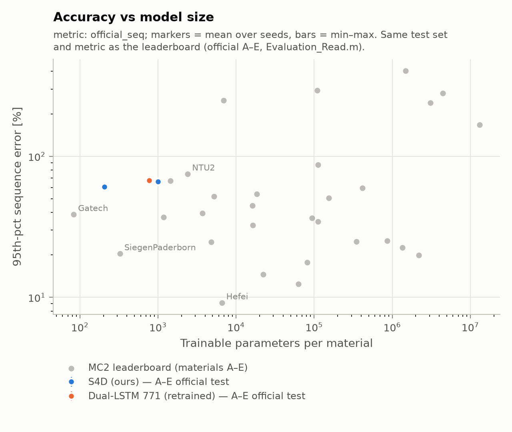

# Phase 2: phase 1 plus H-history noise (2026-11-05, MPS)

Identical to `results/final_AtoE/` (official A–E protocol, same splits, recipe, selection and
scorer) except for `--h-noise 0.05`: Gaussian noise with std 0.05 (normalized units) added to
the H-history window of every training batch. It simulates the model seeing its own imperfect
predictions during rollout. One seed. Wall clock about 2 h 55 min.

## Results (official score, %, lower is better)

Sequence error:

| model | params | A | B | C | D | E | **mean** | phase 1 mean | rank / 35 |
|---|---|---|---|---|---|---|---|---|---|
| S4D small (d4, L1, N8) | 205 | 85.0 | 51.5 | 79.1 | 36.2 | 53.0 | **61.0** | 257.7 | 22 |
| S4D medium (d8, L2, N16) | 1,001 | 89.5 | 94.4 | 43.3 | 38.8 | 64.9 | **66.2** | 689.6 | 23 |
| Dual-LSTM, official arch. | 771 | 106.2 | 27.2 | 76.0 | 37.5 | 91.6 | **67.7** | 163.1 | 25 |

Energy error (mean): S4D small 17.0, Dual-LSTM 19.2, S4D medium 22.2.

Leaderboard neighbours (same test and metric): Aalborg2 59.5 % (rank 21), Princeton 66.8 %,
NTU2 75.1 % (stock 2,399-param LSTM). Small-model reference points: SiegenPaderborn 20.4 %
(325 params), Cambridge 37.0 % (1,182), Gatech 38.8 % (83).

## Reading

- Noise on the H history cut the mean error 2.4x (LSTM) to 10x (S4D medium). Drift was the
  dominant failure in phase 1, and this is direct evidence for it.
- With noise, the smallest S4D (205 params) has the best mean among our models and beats
  NTU2's stock 2,399-param LSTM. The spread between our three models (61–68 %) is small next
  to the per-material variation, and with one seed it is **not** a reliable ordering.
- Per-material results differ a lot. The LSTM is best on B (27 %) and the S4D medium on C
  (43 %, the zero-history material).
- We are still 3x behind SiegenPaderborn at a similar size.

Next: multi-step (rollout) training loss, an h-noise sweep, and 3 seeds per configuration.
