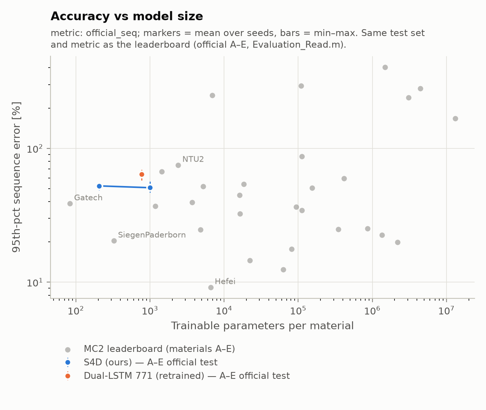

# Three seeds per model at σ = 0.1 + multi-step stage (2026-11-05/06, MPS)

Official A–E protocol (as in `results/final_AtoE/`), H-history noise σ = 0.1, stage 2 with
K = 32 (kept only if it beats stage 1 on validation). The setting was chosen by the noise
sweep on validation error (`results/sweep_noise/`). Seeds 1, 2, 3 vary model init and batch
order on a fixed data split. 45 runs, 11:31 → 00:22, including about 1 h paused while the
lid was closed (17:26–18:29). Launch script: `scripts/runs/seeds3.sh`.

## Official sequence error (%, lower is better)

| model | params | seed 1 | seed 2 | seed 3 | **mean ± sd** | energy mean ± sd | rank / 35 |
|---|---|---|---|---|---|---|---|
| S4D medium | 1,001 | 49.0 | 46.8 | 56.6 | **50.8 ± 5.1** | 16.0 ± 0.8 | 19 |
| S4D small | 205 | 48.8 | 53.2 | 55.2 | **52.4 ± 3.3** | 19.6 ± 6.6 | 21 |
| Dual-LSTM (official arch.) | 771 | 69.4 | 57.7 | 64.8 | **64.0 ± 5.9** | 14.9 ± 2.5 | 24 |

Rank: among the 32 teams plus our three models, by seed-mean sequence error.

Per material, mean ± sd over seeds:

| model | A | B | C | D | E |
|---|---|---|---|---|---|
| S4D medium | 99.0 ± 11.3 | 31.6 ± 16.5 | 47.2 ± 3.7 | 30.6 ± 1.5 | 45.7 ± 2.0 |
| S4D small | 91.6 ± 8.6 | 24.4 ± 2.5 | 57.3 ± 5.5 | 35.6 ± 2.5 | 53.3 ± 6.3 |
| Dual-LSTM | 102.2 ± 1.8 | 25.4 ± 2.4 | 77.0 ± 9.4 | 48.4 ± 7.3 | 67.0 ± 15.8 |

## Paired comparisons (same split; pairs = 5 materials × 3 seeds)

| comparison | seed-mean difference | better on | exact sign-flip p |
|---|---|---|---|
| S4D small − Dual-LSTM | −11.6 pts (−20.6, −4.5, −9.5) | 14 / 15 pairs | 0.0011 |
| S4D medium − Dual-LSTM | −13.2 pts (−20.4, −10.9, −8.2) | 12 / 15 pairs | 0.014 |
| S4D medium − S4D small | −1.6 pts (+0.2, −6.4, +1.3) | 11 / 15 pairs | 0.61 |

The p-value is an exact two-sided paired permutation test on the 15 per-(material, seed)
differences (all 2^15 sign flips). Pairs are not fully independent (materials share a
recipe and selection procedure), so treat p as indicative.

## Reading

- **Both S4D models beat the 771-param Dual-LSTM on every seed**, by 11.6–13.2 points of
  sequence error, under identical data, training and selection. The 205-param S4D wins on
  14 of 15 material–seed pairs with **a quarter of the LSTM's parameters**.
- **The two S4D sizes are not distinguishable** (−1.6 pts, p = 0.61). A 5× larger S4D bought
  no clear accuracy here.
- **Energy error does not follow:** the LSTM has the lowest mean energy error (14.9 %), S4D
  medium 16.0 %, S4D small 19.6 % with large seed spread (12.3–25.2 %). The S4D advantage is
  on waveform (sequence) error.
- **Material A (~95 training sequences) is the weak point for every model** (92–102 %) and
  the noisiest across seeds. B for S4D medium has one outlier seed (50.6 % vs 20.8 / 23.5 %).
- **Position:** S4D medium 50.8 % ranks 19/35, ahead of UESTC (52.0 %, 5,202 params), ASU
  (54.1 %, 18,337), Aalborg2 (59.5 %, 415,753) and NTU2 (75.1 %, 2,399). Small-model
  frontier still ahead: SiegenPaderborn 20.4 % (325), Cambridge 37.0 % (1,182), Gatech
  38.8 % (83).
- Single-seed numbers overstated the S4D small: the sweep's 48.8 % was its best seed; the
  3-seed mean is 52.4 %.
